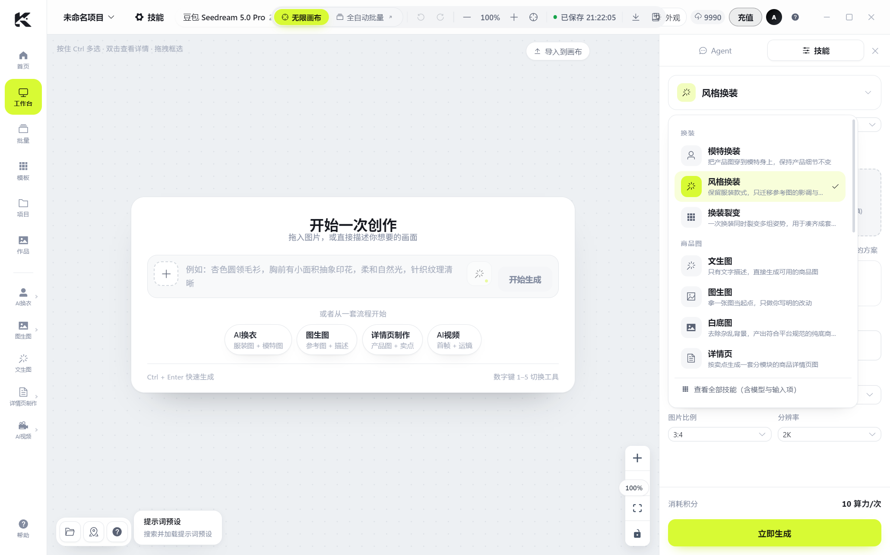

# 跨多多 AI 创作台（ai-canvas）

无限画布式的 AI 电商视觉创作台：一张画布上完成「商品图 → 参考图 → 出图 → 批量 → 审核」，
后端在本机或服务器上代调各家图像模型（通义万相 / 即梦 Seedream / OpenAI GPT Image / Gemini Nano Banana / 本地 ComfyUI），
前端 Vue 3 + Element Plus，桌面端 Electron。



## 功能

- **无限画布**：节点式工作流（商品图 / 参考图 / 画面描述 / 执行 / 生成结果），缩放、拖拽、框选、多选、复制粘贴、撤销重做
- **技能库**：模特换装 / 风格换装 / 姿势裂变 / 白底图 / 详情页 / 视频等预设工作流，一键铺图
- **批量工作台**：文件夹批量出图、变量命名（`{文件名}`、`{序号}` 等）、断点续跑、失败重试
- **多模型接入**：通义万相、火山方舟 Seedream、OpenAI GPT Image、Gemini Nano Banana、ComfyUI 本地工作流
- **模型 API 自检**：设置页一键测试 Key / 地址 / 模型是否可用，不生成图片、不扣算力
- **账号与算力**：本地账号体系（scrypt）、角色权限、算力账本（预留 / 结算 / 退款）、充值订单与回调验签
- **运营后台**：账号、部门、角色、审计日志、密钥管理、充值/支付管理
- **手机端**：微信小程序（看图 / 出图 / 进度 / 账号），局域网联调
- **桌面端**：Electron 壳、系统托盘、自动更新（electron-updater）、免安装绿色版


## 技术栈

| 层 | 选型 |
|---|---|
| 前端 | Vue 3 + Vite 6 + Element Plus + @vue-flow/* |
| 后端 | Node.js 20 + Express 4（本地/服务器同构） |
| 桌面 | Electron 33 + electron-builder |
| 数据 | JSON 文件（单机模式，`AI_CANVAS_HOME`）；密钥走系统钥匙串或本地加密文件 |
| 测试 | 自研 `scripts/run-tests.mjs`，39 套端到端/单元用例 |

## 目录结构

```
src/                 Vue 3 前端（components 画布/技能/批量/后台，store 状态）
server/              Express 后端（账号、算力、支付、模型网关、provider 适配、API 自检）
electron/            桌面壳（main / preload / tray / updater）
miniprogram/         微信小程序
scripts/             构建、测试、打包、品牌配置等脚本
deploy/              Docker / Compose / Caddy 部署骨架
public/              运行时静态资源（模板图、品牌素材）
assets/              README 截图
```

## 快速开始（开发模式）

前置：Node.js ≥ 20、Windows 10/11（其他平台未验证）。

```bash
npm install

# 一条命令起「后端 5181 + Vite 5180 + Electron 开发态」
npm run dev:desktop

# 状态 / 停止
npm run dev:status
npm run dev:stop
```

打开后按首屏引导创建管理员账号，登录进工作台。
右上角「设置」里填各模型的 API Key，点「测试连接」确认连通（自检不扣算力）。

> 只想用浏览器版：`npm run dev`（Vite）+ 另开一个终端 `npm run server`，访问 `http://127.0.0.1:5180`。

## 生产运行

```bash
npm run build        # 构建前端到 dist/
npm run server       # 后端 + 静态站点，默认 http://127.0.0.1:5181
```

Docker 部署见 [`deploy/README.md`](deploy/README.md)（Caddy 自动 HTTPS、数据卷、备份与三个已知坑）。

## 桌面端打包

```bash
npm run dist         # 安装包 + 免安装版（electron-builder）
npm run portable     # 免安装版 + 校验
```

产物在 `release/`（已 gitignore）。当前构建**未做代码签名**，Windows SmartScreen 会提示未知发布者。

## 环境变量

| 变量 | 说明 |
|---|---|
| `AI_CANVAS_HOME` | 数据根（账号、算力账本、配置、输出、素材） |
| `AI_CANVAS_OUTPUTS` / `AI_CANVAS_MATERIALS` | 产出 / 素材目录，默认在数据根下 |
| `AI_CANVAS_VAULT` | `file` = 强制用本地加密文件存密钥（默认优先系统钥匙串） |
| `PORT` / `AI_CANVAS_BIND` | 后端端口 / 监听地址（容器部署设 `0.0.0.0`） |
| `BRAND` | 白标品牌键（`aichange` / `jingling` / `xmulo` / 自定义） |

## 测试

```bash
npm test
```

覆盖算力账本、支付回调、模型网关、prompt 编译、技能库、画布剪贴板、API 自检、手机端接口等 39 套用例。

## 数据与安全

- 默认单机运行：数据与密钥都在本机（`AI_CANVAS_HOME`），不上传云端
- 厂商 API Key 存在系统钥匙串（不可用时退化为本地加密文件），**不进仓库、不回显**
- 仓库里没有真实 Key / 账号 / 数据库

## 已知限制

- 目前主要面向 Windows；其他平台需自行验证
- 未做代码签名；未声明开源许可证（默认保留所有权利，如需开源请补 LICENSE）
- 多租户 / 云端同步尚未实现：当前是「单机后端 + 桌面/浏览器/小程序多端接入」

## 相关

- 部署：[`deploy/README.md`](deploy/README.md)
- 发布与下载：见 GitHub Releases
